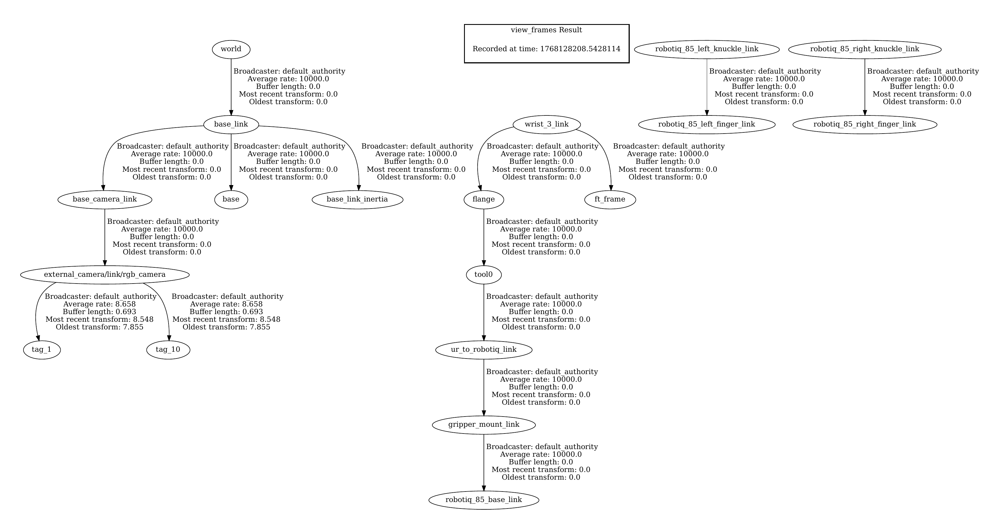
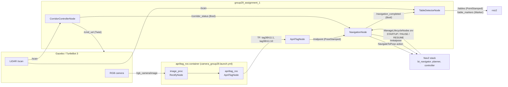
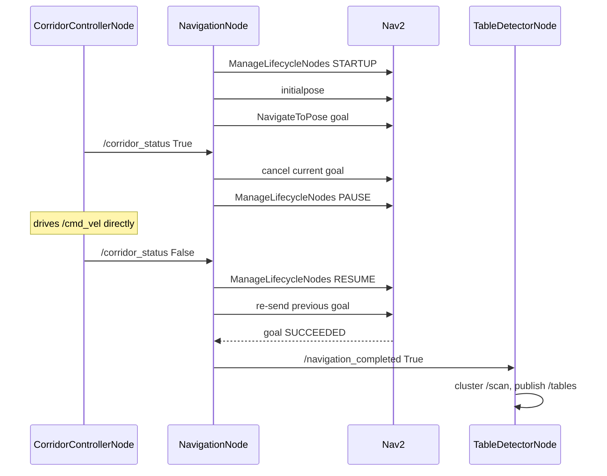

# TurtleBot3 Navigation and Perception

A modular ROS 2 pipeline that drives a simulated **TurtleBot 3** to an
AprilTag-defined goal, navigates there with the **Nav2** stack, hands off to a
**LiDAR corridor-following controller** in narrow passages, and finally detects
**cylindrical tables** from laser scans.

Two interchangeable estimator implementations are included, exactly as they were
developed:

| Implementation | Package | Estimator | Corridor control |
|---|---|---|---|
| **A** | `group29_assignment_1_kalman` | Linear **Kalman filter** (constant-velocity) | — |
| **B** | `group29_assignment_1` | Baseline TF midpoint (arithmetic mean) | ✔ LiDAR corridor controller |

> Package names retain the original course naming (`group29_assignment_*`) so that
> they stay consistent with the accompanying report and the original commit
> history. See [`docs/CHANGES.md`](docs/CHANGES.md) for the exact edits made
> during preparation.

---

## Contents

- [Overview and objectives](#overview-and-objectives)
- [Features](#features)
- [Demo](#demo)
- [System architecture](#system-architecture)
- [How it works](#how-it-works)
- [Repository layout](#repository-layout)
- [Technologies and dependencies](#technologies-and-dependencies)
- [Installation and build](#installation-and-build)
- [Running the system](#running-the-system)
- [Configuration](#configuration)
- [Results](#results)
- [Known limitations](#known-limitations)
- [Reproducibility status](#reproducibility-status)
- [My contribution](#my-contribution)
- [Licence and acknowledgements](#licence-and-acknowledgements)

---

## Overview

An autonomous indoor navigation system for a TurtleBot 3 that solves a problem
general-purpose planners handle poorly: **the goal is not given in advance but
encoded in the environment**, and the route to it passes through a narrow
corridor where the planner is unreliable.

The system derives its goal at runtime from a pair of AprilTag markers, drives to
it with Nav2, detects corridor entry from LiDAR alone and takes over low-level
control while inside it, then hands control back to Nav2 on exit. On arrival it
detects cylindrical tables from the laser scan.

Two interchangeable estimator implementations are included, so the design decision
they represent can be compared directly:

1. Runtime goal extraction from two AprilTag detections, with no hard-coded waypoints.
2. Nav2 path planning and execution, driven through the `NavigateToPose` action.
3. LiDAR-only corridor detection with hysteresis, and a proportional controller
   active only inside the corridor.
4. A hand-off protocol that pauses and resumes the Nav2 lifecycle around the
   manual segment, then re-issues the goal.
5. Euclidean-clustering table detection with geometric acceptance criteria.
6. A baseline estimator versus a **Kalman-filtered** estimator for the
   tag-derived goal position.

Everything runs in **Gazebo simulation** on a TurtleBot 3.

## Features

- **Runtime goal extraction** from two AprilTags — no hard-coded waypoints. The
  goal is the midpoint between tag `tag36h11:1` and tag `tag36h11:10` in the
  `map` frame.
- **Nav2 integration through the full lifecycle** — the node starts, pauses and
  resumes the Nav2 lifecycle managers programmatically rather than assuming the
  stack is already active.
- **Kalman-filtered goal estimation** (`[x, y, vx, vy]` constant-velocity model),
  which suppresses the jitter of successive tag detections.
- **LiDAR corridor detection with hysteresis** — entry and exit thresholds differ,
  so the controller does not chatter on the boundary.
- **Corridor hand-off protocol**: the navigation goal is cancelled, Nav2 is
  paused, the corridor controller drives the robot, and on exit Nav2 is resumed
  and the goal is re-sent.
- **Euclidean-clustering table detection** with a width filter tuned to the
  table diameter, and marker publishing for visualisation in rviz.
- **Change-triggered publishing** so the goal is not re-sent for sub-centimetre
  fluctuations.

## Demo

Recorded demonstrations of both implementations (authored by the project team):

| Demonstration | Shows |
|---|---|
| *Normal navigation with bonus part* | Implementation B — baseline estimator with the LiDAR corridor controller |
| *Navigating with Kalman filter without bonus* | Implementation A — Kalman-filtered estimator |

Both are in the project's public video folder:
**<https://drive.google.com/drive/folders/1hunotXlMFh6AQY6Q9B9w4cY3GzINZ1f5>**

A real transform tree captured during a run of Implementation B is included below
(source: ROS 2 `view_frames`; `.gv` and `.pdf` alongside). It is evidence that
the perception, robot and Nav2 frames were all live and connected.



## System architecture

Four nodes, plus a composable AprilTag container supplied by upstream
`apriltag_ros`. They communicate **only** through topics, actions and services.



### Interface reference

Derived directly from the source.

| Endpoint | Type | Direction | Node | Purpose |
|---|---|---|---|---|
| `/midpoint` | `geometry_msgs/PoseStamped` | pub | AprilTagNode | goal position between the two tags |
| `/corridor_status` | `std_msgs/Bool` | pub / sub | CorridorControllerNode → NavigationNode | corridor entry/exit hand-off |
| `/cmd_vel` | `geometry_msgs/Twist` | pub | CorridorControllerNode | direct drive while in the corridor |
| `/scan` | `sensor_msgs/LaserScan` | sub | CorridorControllerNode, TableDetectorNode | LiDAR |
| `/initialpose` | `geometry_msgs/PoseWithCovarianceStamped` | pub | NavigationNode | seeds localisation |
| `/navigation_completed` | `std_msgs/Bool` | pub / sub | NavigationNode → TableDetectorNode | gates table detection |
| `/tables` | `geometry_msgs/PointStamped` | pub | TableDetectorNode | detected table centres in `map` |
| `/table_markers` | `visualization_msgs/Marker` | pub | TableDetectorNode | cylinder markers for rviz |
| `/navigate_to_pose` | `nav2_msgs/action/NavigateToPose` | action client | NavigationNode | navigation goal |
| `/lifecycle_manager_localization/manage_nodes` | `nav2_msgs/srv/ManageLifecycleNodes` | service client | NavigationNode | localisation lifecycle |
| `/lifecycle_manager_navigation/manage_nodes` | `nav2_msgs/srv/ManageLifecycleNodes` | service client | NavigationNode | navigation lifecycle |
| `tag36h11:1`, `tag36h11:10` | TF frames | lookup | AprilTagNode | tag poses in `map` |

## How it works

### 1. Goal extraction from AprilTags

`AprilTagNode` looks up the two tag frames in the TF tree and reduces them to a
goal point. The baseline implementation averages the tag positions directly:

```
x_mid = (x_1 + x_2) / 2 ,   y_mid = (y_1 + y_2) / 2
```

It runs on a 2 Hz timer, rounds the result to centimetres, and **only publishes
when the rounded value changes** — a simple debounce that stops the navigator
being re-tasked for noise.

### 2. Kalman-filtered estimation (Implementation A)

`group29_assignment_1_kalman/src/april_tag_node.py` replaces the raw average with
a linear Kalman filter, since successive TF lookups of the same tag are visibly
noisy.

- **State** `x = [x, y, vx, vy]ᵀ` — a constant-velocity model.
- **Transition** `F` is the identity with `F[0,2] = F[1,3] = dt`, `dt = 0.1 s`
  (10 Hz).
- **Observation** `H = [[1,0,0,0],[0,1,0,0]]` — position only; the velocity is
  inferred, never measured.
- **Noise** `R = 15·I₂` (large measurement noise) against `Q = 0.0001·I₄` (small
  process noise). The ratio is deliberate: the tags are static, so the filter is
  tuned to trust the model and smooth away detection jitter.
- **Initialisation** — the first measurement seeds the state directly, so the
  filter never starts from an arbitrary origin.

Standard predict/update recursion:

```
predict:  x̂ ← F x̂ ,        P ← F P Fᵀ + Q
update:   y  = z − H x̂ ,    S = H P Hᵀ + R ,   K = P Hᵀ S⁻¹
          x̂ ← x̂ + K y ,     P ← (I − K H) P
```

The output uses the `target_frame` parameter as its `frame_id`, and republishes
only when the estimate moves more than a **0.07 m** tolerance.

### 3. Corridor detection and control

`CorridorControllerNode` reads the LiDAR and looks at two narrow angular sectors
— left (85°–95°) and right (265°–275°) — taking the mean range in each.

| Constant | Value | Meaning |
|---|---|---|
| `CORRIDOR_THRESHOLD` | 0.55 m | both walls closer than this ⇒ corridor |
| `EXIT_MULTIPLIER` | 1.5× | either wall beyond 0.825 m ⇒ exit |
| `FRONT_CLEARANCE` | 0.45 m | stop if the front range drops below this |
| `LINEAR_SPEED` | 0.35 m/s | corridor traversal speed |
| `KP_ANGULAR` | −0.05 | proportional heading gain |

The separation between the entry (0.55 m) and exit (0.825 m) thresholds is
**hysteresis**: it prevents the robot from flip-flopping between "in corridor" and
"not in corridor" when a wall reading sits near the boundary. While inside, the
controller drives `/cmd_vel` directly with a proportional steering law:

```
ω = (right − left) · KP_ANGULAR
v = LINEAR_SPEED   if front > FRONT_CLEARANCE   else 0
```

### 4. Navigation and the corridor hand-off

`NavigationNode` is a small state machine —
`IDLE → WAITING_TARGET → NAVIGATING → (RETRYING | MANUAL_CONTROL)`.

On startup it waits for both Nav2 lifecycle services, issues `STARTUP`, waits for
`bt_navigator` to report `active`, and publishes an initial pose with a non-zero
covariance so AMCL has something to work with.

The interesting part is the hand-off, which crosses three nodes:



Goal results are mapped explicitly: status `4` (`SUCCEEDED`) publishes
`/navigation_completed`; status `2` is treated as an early return. Rejected goals
are retried up to three times.

### 5. Table detection

`TableDetectorNode` stays idle until `/navigation_completed` arrives, then
processes `/scan` once:

1. Convert every valid range to a Cartesian point using `angle_min` and
   `angle_increment` — so the scan is handled as a true 2-D point cloud.
2. **Euclidean clustering**: walk the points in scan order, starting a new cluster
   when the gap to the previous point exceeds **0.4 m**; discard clusters with
   fewer than 3 points.
3. **Width filter**: keep clusters whose endpoint-to-endpoint distance is between
   **0.05 m and 0.45 m** — the expected chord across a cylindrical table.
4. **Centroid** each surviving cluster and reject one whose centre is within
   **0.5 m** of an already-accepted table (removes duplicates when the same table
   is seen in consecutive scans).
5. Transform the centre from `base_scan` to `map` with tf2 and publish both a
   `PointStamped` and a rviz `Marker` cylinder (colour-coded by index).
6. Stop after **3** tables.

## Repository layout

```
turtlebot3-navigation-perception/
├── README.md
├── LICENSE                     Apache-2.0
├── CONTRIBUTORS.md
├── docs/
│   ├── CHANGES.md              every edit made during preparation
│   ├── UPSTREAM_DEPENDENCIES.md  provenance + licensing of the simulation env
│   ├── RUNNING.md              what the external launch must provide
│   ├── AI_USAGE_DISCLOSURE.md  carried over from the report
│   ├── figures/
│   │   ├── tf_tree_baseline_run.png / .pdf / .gv
│   └── reports/
│       └── Group29_Assignment1_Report.pdf
└── src/                        <- colcon workspace root
    ├── group29_assignment_1/          Implementation B (baseline + corridor)
    └── group29_assignment_1_kalman/   Implementation A (Kalman)

third_party/
└── ir_2526/                    vendored simulation environment
    ├── README.md               provenance + licence status
    ├── NOTICE                  attribution for every author and upstream project
    ├── ir_launch/              simulation entry points
    └── ir_base/                world, map, params, URDFs, AprilTag models
```

The repository root **is** the colcon workspace, so `colcon build` is run from
the root and picks up both `src/` and `third_party/`.

## Technologies and dependencies

| Layer | Used |
|---|---|
| Middleware | ROS 2 (`rclpy`) |
| Navigation | Nav2 — `bt_navigator`, `NavigateToPose` action, lifecycle management |
| Perception | `apriltag_ros`, `image_proc` (composable nodes, intra-process comms) |
| Transforms | `tf2_ros`, `tf2_geometry_msgs` |
| Messages | `geometry_msgs`, `sensor_msgs`, `nav_msgs`, `nav2_msgs`, `visualization_msgs`, `std_msgs`, `apriltag_msgs` |
| Maths | NumPy (scan arithmetic, Kalman filter) |
| Simulation | Gazebo with TurtleBot 3 |
| Build | `ament_cmake`, `colcon` |

A full machine-readable list is declared in each package's `package.xml`.
**Note:** the preparation pass added several dependencies that the code imports
but the original manifests omitted (`visualization_msgs`, `python3-numpy`,
`rclcpp_components`, `apriltag_ros`, `image_proc`) — see
[`docs/CHANGES.md`](docs/CHANGES.md).

## Installation and build

### 1. System prerequisites

| Requirement | Notes |
|---|---|
| Ubuntu | 22.04 (ROS 2 Humble) or 24.04 (ROS 2 Jazzy) — see the distribution note below |
| ROS 2 desktop | `ros-$ROS_DISTRO-desktop`, which includes Gazebo (`gz`/`ros_gz`) |
| Nav2 | `navigation2`, `nav2-bringup`, `nav2-minimal-tb3-sim` |
| TurtleBot 3 | `turtlebot3`, `turtlebot3-description`, `turtlebot3-gazebo` |
| AprilTag | `apriltag-ros` (the detector used by `camera_group29.launch.yml`) |
| Image pipeline | `image-proc` |
| Python | `python3-numpy`, `python3-colcon-common-extensions` |

### 2. Install ROS 2 and the system dependencies

```bash
# ROS 2 itself, following the official instructions for your Ubuntu version:
#   https://docs.ros.org/en/ros2_documentation/
# then the project's dependencies:
sudo apt update
sudo apt install -y \
  ros-$ROS_DISTRO-desktop \
  ros-$ROS_DISTRO-navigation2 ros-$ROS_DISTRO-nav2-bringup \
  ros-$ROS_DISTRO-nav2-minimal-tb3-sim \
  ros-$ROS_DISTRO-turtlebot3 ros-$ROS_DISTRO-turtlebot3-gazebo \
  ros-$ROS_DISTRO-apriltag-ros ros-$ROS_DISTRO-image-proc \
  ros-$ROS_DISTRO-ros-gz ros-$ROS_DISTRO-ros-gz-bridge \
  ros-$ROS_DISTRO-ur-description \
  python3-numpy python3-colcon-common-extensions
```

> **Note the `ur-description` line.** It looks out of place on a TurtleBot 3
> project, but the vendored `ir_launch/launch/assignment_1.launch.py` calls
> `get_package_share_directory('ur_description')` unconditionally to build the
> Gazebo resource path. Without it, the simulation launch fails immediately with
> a `PackageNotFoundError`. The line is upstream's own and is left unmodified;
> it is documented here rather than patched, so the vendored file stays
> byte-identical to the commit it came from.

### 3. Get the code and build

This repository **is** the colcon workspace — the project's packages live in
`src/` and the vendored simulation environment in `third_party/ir_2526/`.

```bash
git clone https://github.com/alishavakhi/turtlebot3-navigation-perception.git ~/ros2_ws
cd ~/ros2_ws
source /opt/ros/$ROS_DISTRO/setup.bash
rosdep install --from-paths src third_party --ignore-src -r -y
colcon build --symlink-install
source install/setup.bash
```

`colcon` discovers packages recursively, so this builds both the project's two
packages and the vendored environment. To build only the project's own code:

```bash
colcon build --symlink-install --packages-select group29_assignment_1
```

> **ROS 2 distribution.** The original project never declared one, and no
> distribution name appears anywhere in the source, launch files or report. It has
> deliberately **not been guessed** here — see
> [Reproducibility status](#reproducibility-status). The packages are written
> against the `rclpy` / Nav2 APIs current in Humble and Jazzy, but this has not
> been confirmed by building.

### 4. The simulation environment — vendored

No external repository needs to be cloned. The Gazebo world, occupancy map,
TurtleBot 3 and camera descriptions, AprilTag models and Nav2 tuning are all
included under [`third_party/ir_2526/`](third_party/ir_2526/), vendored at the
exact upstream commit this project was verified against:

```
third_party/ir_2526/   ir_launch + ir_base
                       @ PieroSimonet/ir_2526 d19ae761
```

These files were written by **Piero Simonetto** (University of Padova), not by
this project's author, and are redistributed with his permission. They are
**not** covered by this repository's Apache-2.0 licence. Authorship, the exact
provenance, the licence status of every component and the build instructions are
documented in [`third_party/ir_2526/README.md`](third_party/ir_2526/README.md)
and [`third_party/ir_2526/NOTICE`](third_party/ir_2526/NOTICE); the reasoning and
the full component matrix are in
[`docs/UPSTREAM_DEPENDENCIES.md`](docs/UPSTREAM_DEPENDENCIES.md).

Every vendored file is byte-identical to upstream — no header, copyright notice
or licence declaration was altered.

## Running the system

```bash
# TurtleBot 3 and the navigation stack
ros2 launch ir_launch assignment_1.launch.py

# in a second terminal — Implementation B (baseline estimator + corridor controller)
ros2 launch group29_assignment_1 assignment1.launch.py

# or Implementation A (Kalman-filtered estimator), instead of the line above
ros2 launch group29_assignment_1_kalman assignment1.launch.py
```

Both implementations build a `LaunchDescription` that includes the
AprilTag/rectify composable container, includes the simulation launch, and starts
the nodes. In Implementation B the corridor controller is started as a fourth
node; in Implementation A it is not.

### What to expect

A successful run looks like this:

1. Gazebo opens with the arena world; the TurtleBot 3 spawns at the world's start
   pose and rviz loads `cfg/assignment_view.rviz`.
2. `apriltag_ros` detects `tag36h11:1` and `tag36h11:10`, publishing each as a TF
   frame. Both appear in rviz's TF display.
3. `AprilTagNode` publishes a goal on `/midpoint` once both tags are visible.
4. `NavigationNode` brings Nav2 up through its lifecycle, publishes an initial
   pose, and sends the goal. The robot drives toward the midpoint.
5. On entering the corridor, `/corridor_status` goes `true`, Nav2 is paused, the
   corridor controller takes over `/cmd_vel`, and the robot drives through. On
   exit, Nav2 resumes and the goal is re-sent.
6. On arrival, `/navigation_completed` goes `true` and the table detector clusters
   the laser scan, publishing up to three table centres on `/tables` with cylinder
   markers on `/table_markers`.
7. `[Nav] Ready. Waiting for midpoint...` from `NavigationNode` and
   `SUCCESS: All 3 tables found.` from `TableDetectorNode` are the two log lines
   that indicate the run completed as intended.

The recorded demonstrations of both implementations are linked under
[Demo](#demo) above.

[`docs/RUNNING.md`](docs/RUNNING.md) documents every topic, service and frame the
nodes depend on, and what the external launch must therefore provide.

## Configuration

**`cfg/tags_36h11_group29.yaml`** — `apriltag_ros` detector parameters.

| Parameter | Value | Note |
|---|---|---|
| `family` | `36h11` | tag family |
| `size` | `0.05` m | tag edge length |
| `max_hamming` | `0` | strict: no error correction |
| `detector.threads` | 4 | |
| `detector.decimate` | 2.0 | quad detection downsampling |
| `detector.refine` | True | snap to gradients |
| `pose_estimation_method` | `pnp` | |
| `tag.ids` | `[0,1,2]` (B) / `[1,10]` (A) | the implemented IDs are `1` and `10` |
| `camera_frame` | `external_camera/link/rgb_camera` | Implementation A only |

**`cfg/assignment_view.rviz`** — the rviz layout used for the demonstrations.

Node parameters (declared in code, overridable at launch): `target_frame`,
`tag_frame_1`, `tag_frame_2` for the AprilTag node.

## Results

### Verification status — read this first

There are two distinct things here, and conflating them would be misleading:

| | Status |
|---|---|
| **The original implementation, in the original simulation environment** | **Tested and working.** Both implementations ran end to end in Gazebo. This is evidenced by the recorded demonstrations, by the transform tree captured live during a run (below), and by the results written up in the accompanying report. |
| **A fresh build and run of *this* repository** | **Not performed.** No ROS 2 installation was available on the machine where this repository was prepared, so `colcon build` and a self-contained launch have not been executed here. |

So: this is a working, tested system whose *packaging* is unverified — not an
untested system. The distinction matters, and no result below is invented.

### What the original runs demonstrated

The accompanying report describes the system as operating reliably in simulation,
with clean coordination between perception, navigation and low-level control. The
corridor traversal completed without manual intervention and without Nav2
recovery behaviours on that run, and both the Kalman-filtered estimator and the
baseline estimator were exercised and recorded.

### Quantitative results

**No numeric metrics are published here, because none were recorded during the
original work.** There is no success-rate table, no timing measurement and no
accuracy figure in the source, the report or the git history. Rather than present
invented numbers, this section records only what is actually evidenced:

- the pipeline ran end to end in Gazebo — evidenced by the recorded
  demonstrations and the live transform tree;
- the corridor hand-off worked in the recorded run: control passed from Nav2 to
  the corridor controller and back, without manual intervention;
- the table detector's acceptance criteria are explicit and geometric
  (0.05–0.45 m cluster width, 0.5 m de-duplication radius), so its behaviour is
  inspectable even without a measured score.

Quantifying the estimator — for example comparing position variance between the
baseline and Kalman implementations on the same tag trajectory — is the natural
next step and is listed under [Known limitations](#known-limitations).

## Known limitations

Recorded honestly from reading the code; none of these were altered during
preparation.

1. **The environment is vendored, but the ROS 2 distribution is not pinned.** The
   course's `ir_launch` and `ir_base` packages are included under
   [`third_party/ir_2526/`](third_party/ir_2526/), vendored byte-identically at
   upstream commit `d19ae761`, so no external repository has to be cloned. What
   remains external is ordinary ROS 2 distribution packages
   (`nav2-minimal-tb3-sim`, `ur_description`, `ros_gz`), each under its own
   licence. What is *not* settled is the distribution itself — Humble or Jazzy;
   see [Reproducibility status](#reproducibility-status). Provenance and the
   licence boundary are in
   [`docs/UPSTREAM_DEPENDENCIES.md`](docs/UPSTREAM_DEPENDENCIES.md) and
   [`third_party/ir_2526/NOTICE`](third_party/ir_2526/NOTICE);
   [`docs/RUNNING.md`](docs/RUNNING.md) is the interface reference.
2. **Scan indexing assumes `angle_min == 0`.** The corridor controller computes
   angles as `np.arange(len(ranges)) * angle_increment`, ignoring
   `msg.angle_min`. This is correct for the TurtleBot 3's 360° LiDAR (where index
   0 is the front), but it would place the "left" and "right" sectors incorrectly
   on a sensor with a non-zero start angle. `table_detector.py` handles
   `angle_min` correctly, so the two nodes are inconsistent with each other.
3. **Blocking calls in the constructor.** `NavigationNode.activate_nav2()` uses
   `time.sleep(2.0)` / `time.sleep(3.0)` and a blocking `wait_for_service()` on
   the startup path, and shells out to `ros2 lifecycle get /bt_navigator` via
   `subprocess`. This works but blocks the executor and is fragile if the CLI or
   the node name changes.
4. **The Kalman **launch** file was mis-wired** — it started the *baseline*
   package's executables, so the filter was unreachable via its own launch file.
   **Fixed in this repository** and documented in
   [`docs/CHANGES.md`](docs/CHANGES.md); the shared AprilTag container is still
   taken from `group29_assignment_1`, so both packages must be built.
5. **Log level.** Both AprilTag nodes set their logger to `ERROR` and then call
   `.info()` for the midpoint messages, so those messages are suppressed. Left
   as-is; note that this makes the node quiet by default.
6. **Hard-coded `map` frame in Implementation B.** The baseline node declares a
   `target_frame` parameter and uses it for the lookup, but publishes with a
   hard-coded `"map"` `frame_id` (Implementation A uses the parameter). Harmless
   in the provided world, but inconsistent.
7. **Live `Add files via upload` commit.** The original history's last commit was
   made through GitHub's web uploader, which is why the original repository
   carries no useful message for it. This repository starts from a clean history
   instead.
8. **Table detection is one-shot.** After three tables are found the node latches
   and never rescans.

## Reproducibility status

Two columns, because the answer differs: what the original authors verified in the
original environment, and what was verified during the preparation of *this*
repository. Nothing in the right-hand column was executed here.

| Check | In the original environment | In this repository |
|---|---|---|
| `colcon build` | built and ran | **NOT RUN** — no ROS 2 on the preparation host |
| Launching in Gazebo | ran end to end, recorded | **NOT RUN** here |
| Corridor hand-off | worked in the recorded run | not re-run |
| Table detection | detected tables in the recorded run | not re-run |
| Kalman vs baseline behaviour | both exercised and recorded | not re-run |
| ROS 2 distribution | worked on the course's distribution, **which is not declared anywhere** | still undetermined |
| Dependencies declared in `package.xml` | several were missing | **fixed** (see `docs/CHANGES.md`) |
| Kalman launch-file wiring | started the wrong package | **fixed**, untested |
| Python syntax of every node | — | verified (`py_compile`) |
| `package.xml` well-formed, deps cross-checked against imports | — | verified |
| Node / topic / action / service names documented in this README | — | verified against source |
| Secrets and personal data | — | verified absent |
| Vendored third-party code | — | present and intentional: `third_party/ir_2526/` only, hashed byte-identical to upstream `d19ae761` (see `docs/CHANGES.md`) |

Every interface documented in this README was read from the source, not inferred.
The build and launch commands follow standard ROS 2 practice for this workspace
shape and are consistent with the environment the project originally ran in, but
they have not been executed as part of this repository's preparation.

## My contribution

This was a **two-person group project** (Group 29). Work is not presented here as
solely mine.

**Collaborators:** Ali Shavakhi, Vaheid Labbaf — co-authors of the accompanying
report.

Commit-level contribution to the original repository, by package:

| Package | Ali Shavakhi | Vaheid Labbaf | Reading |
|---|---|---|---|
| `group29_assignment_1` (baseline + corridor) | **14 commits** | 5 commits | led by Ali Shavakhi |
| `group29_assignment_1_kalman` (Kalman) | **3 commits** | 0 commits | **solely Ali Shavakhi** |
| overall | 26 of 40 commits | 14 of 40 | |

So the **Kalman-filtered estimator is entirely my own work**, and the baseline
package plus the corridor controller integration was led by me with contributions
from my teammate. The report describes both implementations as jointly authored.

See [`CONTRIBUTORS.md`](CONTRIBUTORS.md).

## Licence and acknowledgements

Licensed under **Apache-2.0** — see [`LICENSE`](LICENSE). The original packages
already carried this licence and declaration; it has been preserved.

**Scope of the licence:** Apache-2.0 covers the source code, configuration and
documentation in this repository — that is, `src/`, `docs/` and the READMEs.

It **does not** cover:

- **`third_party/ir_2526/`** — the vendored simulation environment, written by
  **Piero Simonetto** and redistributed with his permission. Copyright remains
  with the original authors; see
  [`third_party/ir_2526/NOTICE`](third_party/ir_2526/NOTICE). Two model
  directories within it are authored by third parties
  (`models/artag` — Nicola Castaman; `models/cafe_table` — Nate Koenig /
  Open Robotics) and are also not covered.
- **`docs/reports/`** — the academic report, the authors' own work, included with
  the co-author's consent.

No third-party code is vendored outside `third_party/`: Nav2, `apriltag_ros`,
`image_proc`, TurtleBot 3 and Gazebo are consumed as installed upstream packages
under their own licences.

The full academic report is in
[`docs/reports/Group29_Assignment1_Report.pdf`](docs/reports/Group29_Assignment1_Report.pdf).

**AI usage disclosure** (carried over from the report, unchanged): portions of the
work were supported by AI-based language models for non-creative tasks —
debugging assistance during the implementation of the `NavigationNode` startup
sequence, and improving the clarity and formatting of report text. All system
architecture decisions, algorithms, control logic, perception modules and ROS 2
code were designed and implemented by the authors. See
[`docs/AI_USAGE_DISCLOSURE.md`](docs/AI_USAGE_DISCLOSURE.md).

Built on Nav2, `apriltag_ros`, `image_proc`, TurtleBot 3 and Gazebo — all
third-party projects under their own licences.
